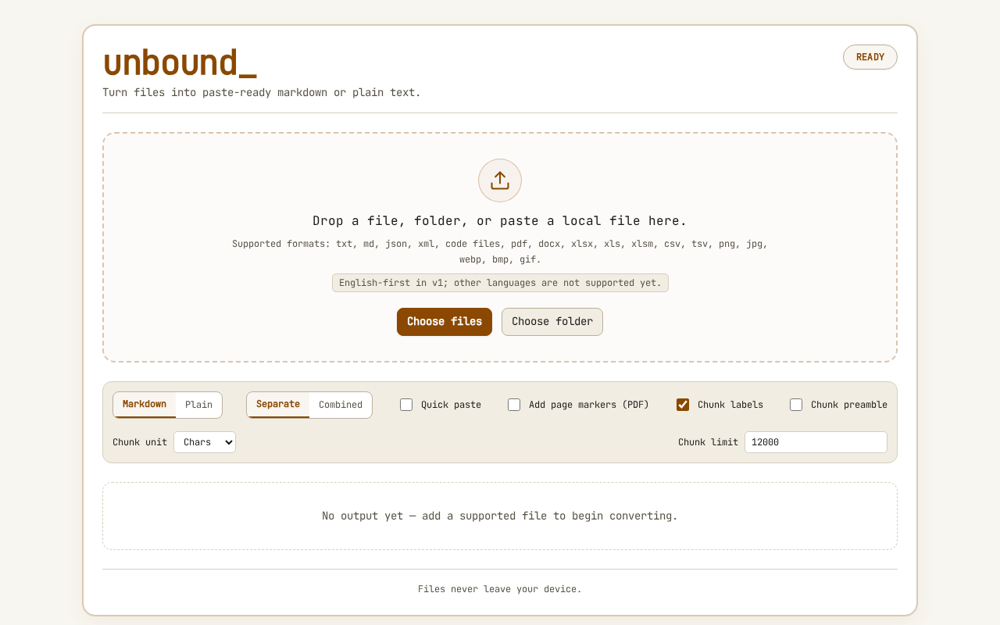
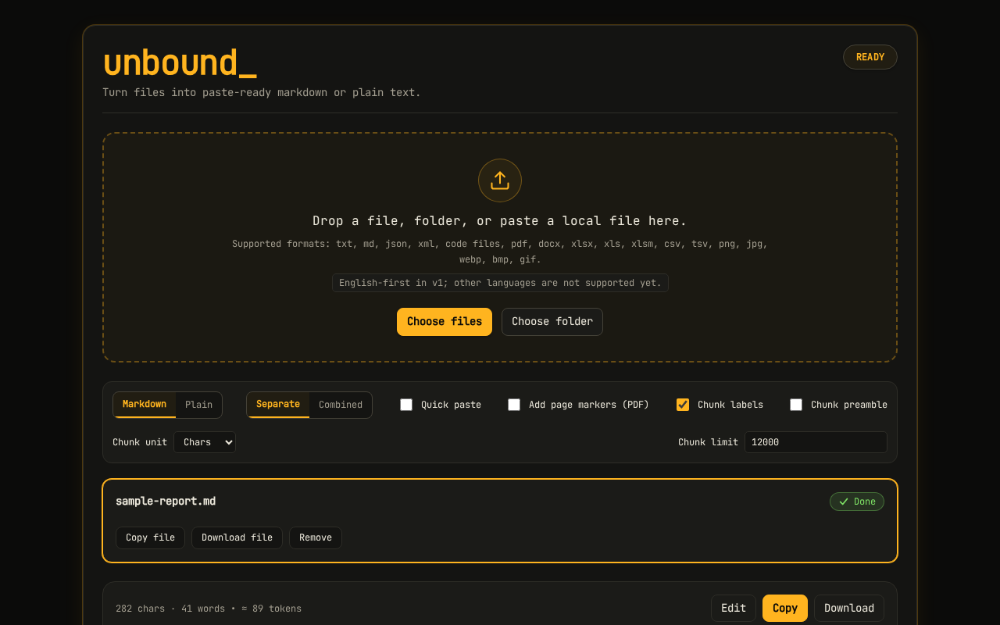
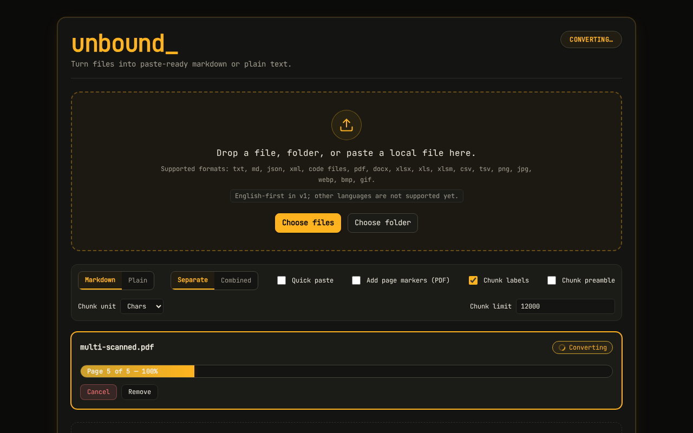
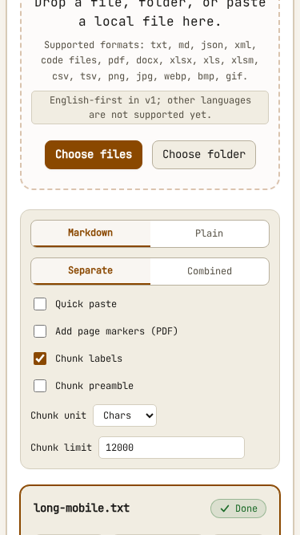
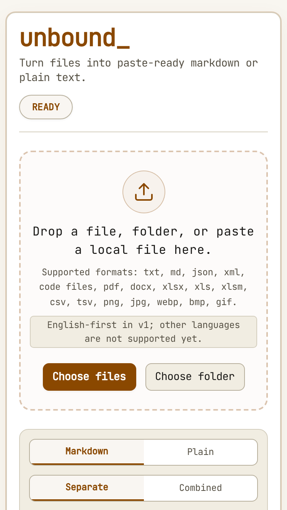

# Unbound

> Turn any document into clean, paste-ready markdown in your browser — bypassing LLM attachment limits.

[](https://unbound-amber-eight.vercel.app/)
[](https://github.com/chiragdhunna/unbound/actions/workflows/ci.yml)
[](https://unbound-amber-eight.vercel.app/)
[](https://unbound-amber-eight.vercel.app/)

**🌐 Production URL:** [https://unbound-amber-eight.vercel.app/](https://unbound-amber-eight.vercel.app/)


### Why Unbound?

- **Paste-ready markdown for LLM chats:** Convert files into clean, structured text that pastes directly into ChatGPT, Claude, Gemini, or Grok without running into file attachment restrictions.
- **Files never leave your browser:** 100% client-side conversion. Zero uploads, zero telemetry, zero server-side storage, and zero external network requests.
- **Works on scanned PDFs and photos of text:** Automatically detects scanned pages and standalone images, running local self-hosted OCR via WebAssembly without cloud APIs.

---

## Table of Contents

- [Supported Formats](#supported-formats)
- [How It Works](#how-it-works)
- [How OCR Works](#how-ocr-works)
- [Privacy & Security](#privacy--security)
- [Supported Browsers](#supported-browsers)
- [Limits & Performance](#limits--performance)
- [Keyboard Navigation & Accessibility](#keyboard-navigation--accessibility)
- [Mobile Experience](#mobile-experience)
- [Design System & Interface](#design-system--interface)
- [Known Limitations](#known-limitations)
- [Documentation](#documentation)
- [Getting Started & Verification Gate](#getting-started--verification-gate)
- [Tech Stack](#tech-stack)
- [License](#license)

---

## How It Works

Unbound converts documents entirely inside your browser using client-side WebAssembly, Web Workers, and specialized parsing libraries:

1. **Upload & Ingestion:** Drop files, select folders (via directory picker), or paste clipboard text. Files are ingested into browser memory as `ArrayBuffer` objects; no bytes are ever uploaded to a server or external service.
2. **Type Detection:** Magic bytes and file headers are inspected (`src/core/detect.ts`) to determine the exact format, inspecting ZIP central directories to distinguish DOCX, PPTX, XLSX, and EPUB even if file extensions are missing or spoofed.
3. **Lazy-Loaded Conversion:** The matching converter module is dynamically imported on demand (`src/core/registry.ts`). Scanned PDF pages and images route to self-hosted Tesseract.js WASM OCR running in a Web Worker.
4. **Copy & Export:** Clean, ATX-formatted markdown with GFM tables and code blocks is rendered in the output panel. Copy directly to clipboard with one click (or auto-copy via quick-paste) or download as `.md` / `.txt`.

---

## Supported Formats

Unbound detects file types via **magic bytes, MIME type, and extension** (`src/core/detect.ts`), correctly identifying files even if their extensions are missing or misleading.

### Supported File Types

| Format | Extension(s) | Processing Method | Notes |
|:-------|:-------------|:------------------|:------|
| **Plain Text** | `.txt` | Pure client decoder | Auto-detects UTF-8, UTF-16, and Windows-1252 encodings. |
| **Markdown** | `.md`, `.markdown` | Pass-through | Preserves headers, lists, code fences, and formatting. |
| **JSON** | `.json` | Formatter | Pretty-printed with 2-space indentation in a syntax-highlighted code fence. |
| **XML** | `.xml` | Pass-through | Wrapped in an XML-tagged fenced code block. |
| **Code** | `.js`, `.ts`, `.tsx`, `.jsx`, `.py`, `.go`, `.rs`, `.java`, `.c`, `.cpp`, `.cs`, `.rb`, `.php`, `.swift`, `.kt`, `.sql`, `.sh`, `.yaml`, `.yml` | Syntax fence | Tagged with appropriate language identifier; handles nested backtick runs safely. |
| **CSV / TSV** | `.csv`, `.tsv` | Custom RFC-4180 parser | Sniffs delimiters (`,`, `;`, `\t`), strips BOMs, preserves exact literal cell text (leading zeros, exponent notation, quoted spacing). |
| **Rich Text (RTF)** | `.rtf` | Zero-dependency streaming tokenizer | Tokenizes control words and groups; decodes Unicode (`\uN`) and Windows-1252 hex (`\'hh`); maps `\b`, `\i`, `\bullet`, `\par`; skips non-text destinations (`\fonttbl`, `\colortbl`, `\pict`, metadata); emits clean Markdown. |
| **HTML** | `.html`, `.htm` | Inert DOM + Mozilla Readability + Turndown | Safely parses detached DOM via `DOMParser` (scripts never run); extracts article title, byline, and body via `@mozilla/readability`; falls back to cleaned `<body>` with boilerplate stripped (`<nav>`, `<header>`, `<footer>`, `<aside>`); renders GFM tables and code blocks. |
| **DOCX** | `.docx` | Mammoth.js + Turndown | Converts headings, lists, tables, and links to markdown; counts and warns about omitted embedded images. |
| **PowerPoint** | `.pptx` | JSZip + fast-xml-parser | Preserves presentation slide order (`sldIdLst`), titles (`###`), nested bullet levels (`-`), tables (GFM), speaker notes (`**Notes:**`), hidden slides (`## Slide N (hidden)`), and warns about omitted images and charts (`PPTX_NON_TEXT_OMITTED`). |
| **XLSX / XLS / XLSM** | `.xlsx`, `.xls`, `.xlsm` | Vendored SheetJS (0.20.3) | Emits `## Sheet: <name>` sections, GFM tables, ISO formatted dates, replicates merged top-left cells, and flags hidden sheets. |
| **PDF (Text)** | `.pdf` | `pdfjs-dist` legacy build | Strips running headers/footers (≥ 60% pages) and bare page numbers; classifies font sizes into `#`, `##`, `###` headings; de-hyphenates words across line breaks. |
| **PDF (Scanned & Mixed)** | `.pdf` | Per-page OCR routing | Evaluates each page: pages with `< 25` characters and graphics operators route automatically to self-hosted OCR. |
| **Images** | `.png`, `.jpg`, `.jpeg`, `.webp`, `.bmp`, `.gif` | Self-hosted Tesseract.js | Decoded locally via Canvas/ImageBitmap; scaled to bounded dimensions; OCR recognized to structured text. |
| **EPUB** | `.epub` | JSZip + fast-xml-parser + Turndown | Follows OPF spine order (never manifest or alphabetical); extracts `dc:title`/`dc:creator` metadata; shifts chapter heading hierarchy down one level (`##` per chapter); warns on omitted images (`EPUB_IMAGES_OMITTED`). |
| **ZIP Archives** | `.zip` | JSZip + recursive sub-pipeline | Recurses nested archives up to depth 3; sanitizes paths against zip-slip; generates an indented ASCII file tree (`## Files`); converts each supported entry via `# File: <path>` boundaries; isolates per-file failures (`> ⚠ <path>: <reason>`). |
| **Folders** | Directory drop / file picker | `webkitdirectory` + pipeline | Labels files by `webkitRelativePath` to disambiguate identical basenames across directories; filters junk and developer artifacts; supports Separate or Combined batch modes. |

### Converting Web Pages

To convert a web page or online article, save it locally in your browser as an HTML file (`.html` / `.htm`) and drop it into Unbound. Unbound makes **zero runtime network requests by design**, and its strict Content Security Policy (`connect-src 'self'`) prohibits outbound network traffic to guarantee complete privacy. All extraction runs 100% offline in your browser.

### Archive & Folder Limits & Safety Bounds

To ensure responsive in-browser performance and prevent decompression bombs or tab freezing, archives and directory uploads enforce strict resource bounds:

| Limit | Value | Scope | Action on Limit |
|:------|:------|:------|:----------------|
| **Max Converted Files** | 500 entries | ZIP & Folder | Returns partial conversion of processed files + `ZIP_LIMIT_REACHED` warning / UI limit banner |
| **Max Uncompressed Bytes** | 200 MB | ZIP | Checked on declared sizes before inflation and tracked during inflation; stops cleanly |
| **Max Per-File Bytes** | 50 MB | ZIP | Skips oversized entry + emits warning; continues converting remainder |
| **Max Output Characters** | 2,000,000 chars | ZIP | Caps output length to avoid browser DOM lockup; returns partial output |
| **Max Archive Recursion** | 3 levels | ZIP | Recurses into nested `.zip` archives up to depth 3; deeper archives skipped |
| **Junk / Artifact Filter** | Automatic | ZIP & Folder | Filters `__MACOSX`, `.DS_Store`, `Thumbs.db`, `.git`, `node_modules`, `.idea`, `.vscode`, `dist`, `build`, `__pycache__`, `*.pyc`, `*.class`, `*.lock`, and lockfiles |

### Unsupported File Types & Explicit Error Messages

When an unsupported or restricted file is uploaded, Unbound throws a typed error displaying an actionable message:

| File Type / Condition | Error Category | Actionable Error Message |
|:----------------------|:---------------|:-------------------------|
| **Legacy PowerPoint (`.ppt`, OLE2)** | `LegacyDocError` | `"Legacy .ppt files are not supported. Save as .pptx and try again."` |
| **Password-Protected PPTX** | `PasswordRequiredError` | `"This PowerPoint is password-protected. Save a copy without a password and try again."` |
| **DRM-Protected EPUB** | `PasswordRequiredError` | `"This EPUB is DRM-protected and can't be converted."` |
| **Password-Protected ZIP** | `PasswordRequiredError` | `"This ZIP is password-protected. Extract it with a password and drop the files instead."` |
| **Unsupported format** | `UnsupportedFormatError` | `"Unsupported format for now (<kind>). Supported: txt, md, json, xml, code, pdf, docx, pptx, rtf, html, epub, zip, xlsx, xls, xlsm, csv, tsv, and image (png, jpg, webp, bmp, gif) files."` |
| **Legacy DOC (`.doc`, OLE2)** | `LegacyDocError` | `"Legacy .doc files are not supported. Please save as .docx and try again."` |
| **Legacy XLS (`.xls`, OLE2)** | `LegacyDocError` | `"Legacy .xls format is not supported. Please save as .xlsx or .csv."` |
| **Password-Protected DOCX** | `PasswordRequiredError` | `"This file is password-protected. Please remove the password and try again."` |
| **Password-Protected XLSX** | `PasswordRequiredError` | `"Password-protected spreadsheets cannot be converted. Please remove the password and re-upload."` |
| **Password-Protected PDF** | `PasswordRequiredError` | `"This PDF is password-protected. Please remove the password to convert."` |
| **Corrupted Binary File** | `CorruptFileError` | `"File appears corrupted or truncated. Please re-export and try again."` |
| **Zero Extractable Text** | `NoTextFoundError` | `"No text found in this PDF. Try a file with selectable text or enable OCR."` |

---

## How OCR Works

Unbound implements an in-browser OCR pipeline that preserves privacy while delivering extraction from scanned documents:

1. **Automatic Page Classification:**
   During PDF parsing, each page's selectable character count and operator list are inspected. Pages with `< 25` text characters and image rendering operators are flagged as scanned.
2. **Dynamic Route Switching:**
   Pure text PDFs are parsed with pdfjs in milliseconds. When scanned pages are encountered, Unbound routes them to the OCR pipeline with a clear notification:
   `"Scanned PDF detected — using OCR"`.
3. **Embedded Image Detection:**
   If a document contains substantial text alongside embedded images that cover ≥ 30% of the page area, Unbound surfaces an advisory alert:
   `"This PDF contains embedded images that may contain text"` with a one-click **Run OCR on this PDF** action.
4. **Self-Hosted WASM Engine:**
   OCR is performed by Tesseract.js running inside an isolated Web Worker (`public/ocr/worker.min.js`) backed by SIMD-enabled WebAssembly (`public/ocr/core/tesseract-core-simd-lstm.wasm.js`) and self-hosted English training data (`public/ocr/lang/eng.traineddata`).
5. **Real-time Progress & Responsive Cancellation:**
   Conversion progress updates via `aria-valuenow` percentage counters (`"Page 2/4 — 58%"`). Users can click **Cancel** at any time; the background worker terminates in under 1 second.
6. **Confidence & Quality Scoring:**
   Mean word confidence is evaluated for each page. If average confidence falls below `60%`, or character count is `< 10` on low-confidence pages, Unbound marks the result with a warning:
   `"OCR confidence is low (NN%) — output looks unreliable. Check the output carefully."`

---

## Privacy & Security

Unbound was designed from day one with a zero-trust, client-only privacy model:

- **Zero Network Traffic:** Once the initial static web assets are loaded into your browser, **no document bytes, metadata, or telemetry are transmitted over the network**.
- **Self-Hosted OCR Assets:** Unlike standard Tesseract.js configurations that download workers and models from unpkg or GitHub CDNs, Unbound serves all worker scripts, WASM binaries, and language data from its own origin (`/ocr/*`).
- **Strict Content Security Policy (CSP):**
  Enforced identically across `index.html`, `_headers`, and `vercel.json`:
  ```
  default-src 'self';
  script-src 'self' 'wasm-unsafe-eval';
  worker-src 'self' blob:;
  style-src 'self' 'unsafe-inline';
  img-src 'self' data: blob:;
  connect-src 'self'
  ```
- **Local Settings Storage Only:** Only UI preferences (e.g. theme, copy preferences, page marker toggles) are stored in `localStorage`. File names and contents are never persisted.

---

## Supported Browsers

Unbound runs on modern evergreen browsers supporting ES2022, WebAssembly (`wasm-unsafe-eval`), Web Workers, and the HTML5 Canvas / OffscreenCanvas APIs.

- **Tested & Verified in CI:**
  - **Chromium** (Desktop Linux, Windows, macOS)
  - **Mobile Chromium** (Pixel 5 emulation)
  - **Mobile WebKit** (iPhone 12 / Safari emulation in GitHub Actions CI)
- **Untested:** Desktop Firefox is currently untested in CI.
- **Older Browser Compatibility & Graceful Errors:** The application runs the `pdfjs-dist/legacy/build/pdf.mjs` build to avoid recent ECMAScript stage 3/4 requirements (e.g. `Map.prototype.getOrInsertComputed` missing in Chromium < 142). If a user accesses Unbound using an outdated browser missing required Canvas or WASM features, the converter catches the missing API and displays an actionable error:
  `"Your browser is missing a feature required to process this PDF (...). Please update your browser."` (never misreported as `"No text found"`).

---

## Limits & Performance

| Dimension | Measured Value | Implementation & Enforcement |
|:----------|:---------------|:-----------------------------|
| **Initial JS Bundle** | **~71.7 KB gzip** | Strictly enforced under 256,000 B budget (`scripts/check-bundle.mjs`). Heavy dependencies (pdfjs, SheetJS, tesseract.js) live in 27 lazy-loaded chunks. |
| **Output Preview Cap** | **200,000 characters** | UI preview caps display at 200,000 chars (`MAX_PREVIEW_CHARS`) to maintain 60fps rendering. The **Copy** and **Download** actions always operate on the full uncapped output. |
| **Large Document Warning** | **300 pages** | Documents exceeding 300 pages (`LARGE_PDF_PAGE_THRESHOLD`) display an advisory note. Page loops yield to the browser UI thread via macrotask yields (`setTimeout(0)`). |
| **OCR Memory Ceiling** | **≤ 3000 px max edge** | Canvas buffers are capped at a 3000px long edge (`MAX_CANVAS_LONG_EDGE`, ~36 MB uncompressed RGBA) and zeroed out upon job completion. |
| **Image Detection Bound** | **First 20 text pages** | Bounded via `MAX_TEXT_PAGES_FOR_IMAGE_DETECTION = 20`. Keeps operator list overhead to 0% for pages 21+. |
| **Cancel Response Time** | **< 1 second** | Worker termination occurs in `< 1` second on both desktop and mobile viewports (`tesseractEngine.terminateWorker()`). |
| **Archive Max Converted Files** | **500 entries** | Capped at 500 entries (`ZIP_MAX_CONVERTED_FILES = 500`, `FOLDER_MAX_FILES = 500`) to prevent tab freezing; returns partial output + warning. |
| **Archive Max Total Size** | **200 MB uncompressed** | Enforced at 200 MB (`ZIP_MAX_TOTAL_UNCOMPRESSED_BYTES = 200 * 1024 * 1024`) before inflation and tracked continuously. |
| **Archive Max Per-File Size** | **50 MB** | Enforced at 50 MB (`ZIP_MAX_FILE_BYTES = 50 * 1024 * 1024`); skips oversized entries and continues archive processing. |
| **Archive Max Output Length** | **2,000,000 chars** | Capped at 2,000,000 characters (`ZIP_MAX_OUTPUT_CHARS = 2_000_000`) to prevent memory exhaustion. |
| **Archive Recursion Depth** | **3 nested levels** | Recurses nested `.zip` archives up to depth 3 (`ZIP_MAX_RECURSION_DEPTH = 3`). |

### Performance Benchmark Suite (Verified in `tests/unit/perf.test.ts`)

| Scenario | Performance Budget | Verified Benchmark |
|:---------|:------------------:|:------------------:|
| **Typical 20-Page PDF** | < 5.0 s | **190 ms** |
| **Typical DOCX (50 sections)** | < 5.0 s | **112 ms** |
| **Typical XLSX (3 sheets, 300 rows)** | < 5.0 s | **42 ms** |
| **Typical PPTX (10 slides)** | < 5.0 s | **36 ms** |
| **Large 320-Page PDF** | < 60.0 s | **772 ms** |
| **ZIP Archive (50 small files)** | < 10.0 s | **88 ms** |
| **EPUB eBook (200 chapters)** | < 5.0 s | **392 ms** |

### Embedded-image detection cost

Measured median conversion times (`pdfConverter.convert`) across 3 runs on 300-page benchmark documents:

| Test Fixture (300 Pages) | Detection OFF | Detection ON | Overhead (%) | Overhead Ratio |
|:-------------------------|:-------------:|:------------:|:------------:|:--------------:|
| **Pure Text PDF** | 575.5 ms | 710.8 ms | +23.5% | 1.235× |
| **Mixed PDF (every 10th page image)** | 554.7 ms | 667.8 ms | +20.4% | 1.204× |

*Decision:* Because detection overhead exceeded the 15% threshold (+23.5% and +20.4%), detection was capped to the first 20 text pages. Low-text OCR routing remains active on every page.

---

## Keyboard Navigation & Accessibility

Unbound is built to meet WCAG AA standards and is verified via automated axe-core scanning:

- **Full Keyboard Navigation:** Navigate entire interface using `Tab` and `Shift+Tab`. Activate file upload directly by pressing `Enter` or `Space` on the DropZone.
- **Visible Focus Rings:** High-visibility outline (`:focus-visible { outline: 2px solid var(--amber); outline-offset: 2px; }`) on all interactive controls (buttons, dropzone, segmented pickers, checkboxes, number inputs).
- **Aria-Live Status Announcements:**
  - `role="status"` with `aria-live="polite"` announces batch conversion progress (e.g. `"Converting file 2 of 5: notes.docx"`).
  - `role="alert"` with `aria-live="assertive"` announces error states immediately to screen reader users.
- **Contrast Ratios:** Exceeds WCAG AA across both themes:
  - Dark Theme: `#ede9dc` text on `#0b0b0a` background (~16:1 ratio); `#a39e90` muted on `#0b0b0a` (~8.5:1 ratio).
  - Light Theme: `#191816` text on `#f8f6f0` background (~15:1 ratio); `#575246` muted on `#f8f6f0` (~6.8:1 ratio).
- **Automated Axe Scans:** 0 critical or serious axe violations across empty, converted, error card, options bar, preview-cap notice, PPTX, EPUB, ZIP with warnings, light theme, and mobile viewport states.

---

## Mobile Experience

Designed mobile-first with verified responsiveness on narrow screens:

- **Responsive Viewport Support:** Verified at 360×640 (small Android) and 390×844 (iPhone 14) viewports with strict zero horizontal scroll (`scrollWidth <= innerWidth`).
- **Accessible Touch Targets:** All buttons, segmented items, and options labels provide touch targets ≥ 44×44 CSS px to prevent missed taps.
- **Sticky Copy Toolbar:** The primary Copy button remains stickily pinned to the viewport bottom (`position: sticky; bottom: max(1rem, env(safe-area-inset-bottom))`) with safe-area inset support, allowing immediate clipboard copying without scrolling back to the top.
- **Touch Drag Hint:** The drop zone displays `"Tap to choose, drop a file, folder, or paste a local file here"` to guide touch device users clearly.

---

## Design System & Interface

Unbound features a terminal-inspired interface built on CSS custom properties (`src/styles/tokens.css`):

| Feature | Light Theme | Dark Theme |
|:--------|:------------|:-----------|
| **Theme Aesthetic** | High-contrast warm paper | Dark terminal console |
| **Accent & Brand** | Warm amber (`#8a4800`, 5.8:1 contrast) | Bright terminal amber (`#ffb41f`, 9.5:1 contrast) |
| **Typography** | `JetBrains Mono` & `IBM Plex Mono` | `JetBrains Mono` & `IBM Plex Mono` |
| **Contrast Compliance** | Strict WCAG AA (≥ 4.5:1 text, ≥ 3:1 UI) | Strict WCAG AA (≥ 4.5:1 text, ≥ 3:1 UI) |
| **Accessibility** | 0 axe-core violations | 0 axe-core violations |

```carousel

<!-- slide -->

<!-- slide -->

<!-- slide -->

<!-- slide -->

<!-- slide -->

```

- **Hero DropZone:** Prominent upload target with format tags, file picker, and folder upload support.
- **Semantic Status Chips:** Job cards display status using both SVG icons and text (e.g. checkmark for `Done`, spinner for `Converting…`, alert for `Error`), never relying on color alone.
- **Sticky Mobile Copy:** On mobile viewports (≤ 640px), the output panel copy button pins stickily to the bottom of the screen (`position: sticky`), enabling instant copying without scrolling back to top.
- **Motion Preference Guard:** Includes `@media (prefers-reduced-motion: reduce)` rules that automatically disable animations and transitions for users with motion sensitivities.

---

## Known Limitations

- **English-Only OCR (v1):** OCR is currently scoped to English using the vendored `eng.traineddata` model. A visible note in the UI informs users. Non-English language models are planned for future releases.
- **No URL Fetching by Design:** Unbound makes zero outbound network requests by design. The strict Content Security Policy (`connect-src 'self'`) prohibits external fetch calls to guarantee complete privacy. To convert a web page or online article, save it locally in your browser as an `.html` / `.htm` file and drop it into Unbound.
- **Encrypted & Password-Protected Files:** Password-protected Office documents (`.docx`, `.pptx`, `.xlsx`), password-encrypted `.zip` archives, and DRM-protected `.epub` files cannot be decrypted client-side without credentials and are rejected with typed, actionable error messages.
- **Legacy Binary Office Formats:** Proprietary binary formats from Office 97–2003 (`.doc`, `.ppt`, `.xls` in OLE2 wrappers) are not supported. Users must save them as modern OpenXML (`.docx`, `.pptx`, `.xlsx`) or `.csv`.
- **Desktop Firefox Untested in CI:** Automated E2E test suites run against Chromium, Mobile Chromium, and Mobile WebKit. Desktop Firefox is currently untested in CI.
- **Complex Scans & Handwriting:** Low-quality scans, blurry camera photos, or handwriting produce lower recognition rates; Unbound flags these with a `"looks unreliable"` warning when confidence is `< 40%`.
- **Unstructured Scanned Tables:** OCR extracts sequential lines of text; complex tables and multi-column layouts inside scanned pages are not reconstructed into markdown grid syntax.
- **Large Scan Processing Time:** Sequential WASM OCR execution on 50+ page scanned documents can take several minutes depending on CPU performance.
- **DOCX Images:** Images inside `.docx` files are not extracted or OCR'd; an informational warning (`IMAGES_OMITTED`) is emitted.
- **PPTX Non-Text Elements:** Images, charts, and SmartArt diagrams inside `.pptx` presentations are not converted to images; an informational warning (`PPTX_NON_TEXT_OMITTED`) is emitted with counts.
- **RTL & Complex Script PDF Ordering:** Non-English and non-Latin scripts (such as CJK, Devanagari, and Arabic) extract Unicode text characters cleanly; however, right-to-left (RTL) scripts in PDF streams may appear in visual glyph order rather than logical reading order due to PDF stream layout conventions.

---

## Documentation

| Document | Description |
|:---------|:------------|
| [`PLAN.md`](PLAN.md) | Implementation blueprint, milestone definitions, and acceptance criteria. |
| [`docs/REQUIREMENTS.md`](docs/REQUIREMENTS.md) | Authoritative scope, format support requirements, and design constraints. |
| [`docs/ARCHITECTURE.md`](docs/ARCHITECTURE.md) | Detailed module architecture, pipeline flow, and Mermaid sequence diagrams. |
| [`PROGRESS.md`](PROGRESS.md) | Append-only milestone progress log, verification records, and audit history. |
| [`DECISIONS.md`](DECISIONS.md) | Architectural decision records (ADRs) with rationale and consequences. |
| [`docs/TRACEABILITY.md`](docs/TRACEABILITY.md) | Requirement-to-test mapping matrix verified by automated gate script. |

---

## Getting Started & Verification Gate

### Prerequisites

- **Node.js ≥ 22** (`package.json` engines requirement)
- **npm ≥ 10**

### Installation & Development

```bash
# Clone the repository
git clone https://github.com/chiragdhunna/unbound.git
cd unbound

# Install dependencies (SheetJS installed from vendor/xlsx-0.20.3.tgz)
npm ci

# Start the Vite development server (runs sync-ocr-assets prebuild automatically)
npm run dev
```

### Running the Verification Gate

The comprehensive local gate script runs all checks enforced by CI:

```bash
# Run full verification gate (lint, typecheck, build, unit+coverage, bundle, traceability)
bash scripts/verify.sh

# Run unit tests with V8 coverage report
npm run test:unit -- --coverage

# Run Playwright E2E tests (Chromium + Mobile Chromium)
npm run test:e2e -- --project=chromium --project=mobile-chromium

# Check initial bundle gzip size against budget
node scripts/check-bundle.mjs

# Verify traceability requirement mappings
node scripts/check-traceability.mjs
```

> [!NOTE]
> `npm run build` triggers `prebuild` (`scripts/sync-ocr-assets.mjs`), synchronizing Tesseract worker and WASM assets from `node_modules` into `public/ocr/`. These assets are git-ignored and deterministically rebuilt.

> [!NOTE]
> Mobile WebKit E2E tests require system WebKit dependencies that may not be present in local Linux environments. GitHub Actions CI acts as the definitive authority for WebKit verification.

---

## Tech Stack

| Component | Technology | Description |
|:----------|:-----------|:------------|
| **UI Framework** | React 18 | Declarative component UI with zero component library dependencies. |
| **Language** | TypeScript (Strict) | Strict typing across all core modules and converter interfaces. |
| **Build & Bundler** | Vite 6 | Lightning-fast HMR and optimized Rollup code splitting. |
| **PDF Extraction** | `pdfjs-dist` (6.4.299) | Legacy build for cross-browser parsing and canvas rendering. |
| **OCR Engine** | `tesseract.js` (7.0.0) | Local WASM LSTM neural net engine with self-hosted assets. |
| **DOCX Parsing** | Mammoth.js (1.8.0) | Semantic HTML extraction from Word documents. |
| **Spreadsheet Parsing** | SheetJS (0.20.3) | Vendored tarball parsing `.xlsx`, `.xls`, `.xlsm` workbooks. |
| **Markdown Conversion**| Turndown + GFM plugin | Clean HTML-to-ATX markdown transformation. |
| **Testing** | Vitest & Playwright | Fast unit tests with V8 coverage; cross-browser E2E testing with `axe-core`. |

---

## License

Unbound is open-source software licensed under the [MIT License](LICENSE).

Third-party libraries, WASM binaries, and fonts used by Unbound are distributed under their respective permissive open-source licenses (MIT, Apache-2.0, BSD-2-Clause, BSD-3-Clause, ISC, SIL OFL-1.1). Complete license texts and attributions are detailed in [THIRD_PARTY_NOTICES.md](THIRD_PARTY_NOTICES.md).

---

<p align="center">
  <strong>⚡ Unbound</strong> — Break free from attachment limits.<br/>
  <sub>Client-side document conversion for the modern LLM workflow.</sub>
</p>
