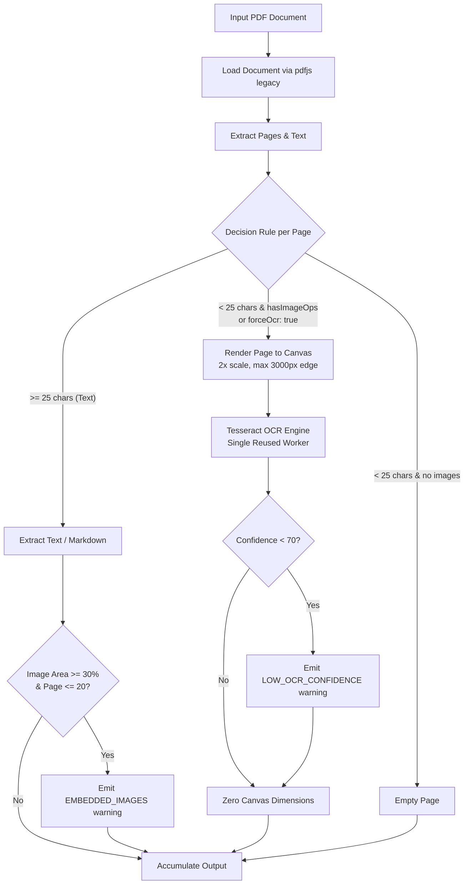

# Architecture Overview

## Browser-Only Processing and Privacy Boundaries

Unbound runs entirely in the browser. No file data is sent to external servers. All conversion occurs client-side using Web APIs (`FileReader`, `Blob`, `Canvas`, Web Workers) and JavaScript libraries.

**Privacy boundary:**

- Files never leave the user's device unless explicitly copied or downloaded.
- Content Security Policy (CSP) is strictly enforced identically across `index.html`, `_headers`, and `vercel.json`:
  `default-src 'self'; script-src 'self' 'wasm-unsafe-eval'; worker-src 'self' blob:; style-src 'self' 'unsafe-inline'; img-src 'self' data: blob:; connect-src 'self'`.
- Zero cross-origin network requests during conversion.
- No analytics, third-party tracking, or external CDNs.
- OCR runtime is completely self-hosted: worker (`/public/ocr/worker.min.js`), core wasm (`/public/ocr/core/tesseract-core-*.wasm.js`), and traineddata (`/public/ocr/lang/eng.traineddata`).
- Only UI settings (never file content or file names) are persisted in `localStorage`.

## Actual Current Flow

1. **Input**: User selects file(s) via drag-and-drop, file picker, or paste.
2. **Detection** (`src/core/detect.ts`):
   - Inspects magic bytes (first 4 KB): `%PDF-`, PK ZIP family (`50 4B 03 04`), OLE2 (`D0 CF 11 E0`), `{\rtf`, PNG, JPEG, GIF, WEBP, BMP.
   - For ZIP files, inspects the central directory (end-of-central-directory record) to differentiate DOCX (`word/`), PPTX (`ppt/`), XLSX (`xl/`), and EPUB (`META-INF/container.xml`).
   - For text without binary signatures, tests UTF-8/UTF-16/Windows-1252 decoding and maps by extension.
3. **Registry & Lazy-Chunk Loading** (`src/core/registry.ts`):
   - Dynamically imports the appropriate converter module on demand via lazy `import()`.
   - Heavy dependencies (pdfjs, SheetJS, tesseract.js, Mammoth, Turndown) remain in lazy chunks and are never in the initial bundle.
4. **Converter**:
   - The converter's `convert` method processes the file bytes with a `ConvertContext` (`signal`, `onProgress`, `requestPassword`, `options`).
   - Returns a `ConvertResult` containing `markdown`, `warnings` array, and `stats`.
5. **Output**:
   - Converted markdown is stored in the job's `rawMarkdown` and `output` fields.
   - React state triggers output rendering, live token/character counting, structure-aware chunking, and clipboard/download handlers.

## Converter Registry & Lazy-Chunk Map

All non-trivial parsers and heavy binary dependencies are partitioned into on-demand lazy chunks to keep the initial application entry strictly under the 256,000 B gzip budget (~71.7 KB measured):

| Format / Kind | Converter Implementation | Chunk Artifact | Dynamic Dependencies | Dynamic Import Trigger |
|:--------------|:-------------------------|:---------------|:---------------------|:-----------------------|
| `pdf` | `src/converters/pdf.ts` | `dist/assets/pdf-*.js` | `pdfjs-dist/legacy/build/pdf.mjs` | First PDF upload |
| `docx` | `src/converters/docx.ts` | `dist/assets/docx-*.js` | `mammoth`, `turndown` | First DOCX upload |
| `xlsx` | `src/converters/xlsx.ts` | `dist/assets/xlsx-*.js` | `vendor/xlsx-0.20.3.tgz` (SheetJS) | First XLSX/XLS/XLSM upload |
| `pptx` | `src/converters/pptx.ts` | `dist/assets/pptx-*.js` | `jszip`, `fast-xml-parser` | First PPTX upload |
| `epub` | `src/converters/epub.ts` | `dist/assets/epub-*.js` | `jszip`, `fast-xml-parser`, `turndown` | First EPUB upload |
| `zip` | `src/converters/zip.ts` | `dist/assets/zip-*.js` | `jszip` | First ZIP archive upload |
| `html` | `src/converters/html.ts` | `dist/assets/html-*.js` | `@mozilla/readability`, `turndown` | First HTML file upload |
| `rtf` | `src/converters/rtf.ts` | `dist/assets/rtf-*.js` | Pure TypeScript tokenizer (zero deps) | First RTF upload |
| `image` | `src/converters/image.ts` | `dist/assets/image-*.js` | `src/converters/ocr/engine.ts` | First image upload |
| `ocr-engine` | `src/converters/ocr/engine.ts` | `dist/assets/tesseract-*.js` | `tesseract.js` | Scanned PDF page or image OCR |
| `csv` | `src/converters/csv.ts` | Core / main chunk | RFC-4180 parser (zero deps) | CSV/TSV upload |
| `plain` / `md` / `code` | `src/converters/{text,code}.ts` | Core / main chunk | Pure string normalization | Text/Code/MD upload |

## Detection Architecture & ZIP Central Directory Introspection

Unbound's detector (`src/core/detect.ts`) avoids brittle file extension reliance by prioritizing content signatures and structural metadata:

```
Buffer Ingestion
  │
  ├── First 4 KB Magic Byte Sniffing
  │     ├── %PDF-                         → 'pdf'
  │     ├── {\rtf                         → 'rtf'
  │     ├── \x89PNG, \xFF\xD8\xFF, GIF8,
  │     │   RIFF...WEBP, BM              → 'image'
  │     ├── \xD0\xCF\x11\xE0 (OLE2 Compound Document)
  │     │     ├── .doc                    → LegacyDocError (.doc unsupported)
  │     │     ├── .ppt                    → LegacyDocError (.ppt unsupported)
  │     │     ├── .xls                    → 'xlsx' (SheetJS binary parser)
  │     │     └── Encrypted Package       → PasswordRequiredError
  │     └── PK\x03\x04 (ZIP Family)
  │           │
  │           └── End-of-Central-Directory (EOCD) Record Parse
  │                 ├── Contains 'word/'                 → 'docx'
  │                 ├── Contains 'ppt/'                  → 'pptx'
  │                 ├── Contains 'xl/'                   → 'xlsx'
  │                 ├── Contains 'META-INF/container.xml'→ 'epub'
  │                 └── Default                          → 'zip'
  │
  └── Plain-Text / Code Sniffing (No binary signatures)
        ├── UTF-8 BOM, UTF-16 LE/BE detection
        ├── Windows-1252 heuristic fallback
        └── Extension mapping (code languages, md, csv, tsv, json, xml)
```

## Archive & Folder Safety Limits

To guarantee responsive performance without browser tab freezing, resource caps are enforced:

| Constant | Value | Purpose & Action on Breach |
|:---------|:------|:---------------------------|
| `ZIP_MAX_CONVERTED_FILES` | 500 entries | Stops archive conversion, returns accumulated markdown + `ZIP_LIMIT_REACHED` warning |
| `FOLDER_MAX_FILES` | 500 files | Halts folder ingestion, renders prominent accessible warning alert (`role="alert"`) |
| `ZIP_MAX_TOTAL_UNCOMPRESSED_BYTES` | 200 MB | Checked against pre-declared uncompressed sizes and inflation tracker; aborts with limit warning |
| `ZIP_MAX_FILE_BYTES` | 50 MB | Skips single oversized entry, logs `> ⚠ <path>: Oversized entry (> 50 MB)`, continues processing |
| `ZIP_MAX_OUTPUT_CHARS` | 2,000,000 chars | Output character ceiling preventing DOM lockup; returns truncated output with warning |
| `ZIP_MAX_RECURSION_DEPTH` | 3 nested levels | Limits recursion into nested `.zip` archives to 3 levels |
| `LARGE_PDF_PAGE_THRESHOLD` | 300 pages | Triggers `PDF_LARGE` advisory note; page extraction yields to UI thread via macrotask yields |
| `MAX_PREVIEW_CHARS` | 200,000 chars | Caps live textarea DOM rendering; Copy and Download always operate on uncapped text |
| `MAX_TEXT_PAGES_FOR_IMAGE_DETECTION` | 20 pages | Bounds embedded image search to first 20 pages, eliminating operator scan overhead on large PDFs |

## Supported Formats (Current Status)

- **Plain Text** (`.txt`): encoding auto-detection (UTF-8, UTF-16, Windows-1252 fallback with warning).
- **Markdown** (`.md`, `.markdown`): pass-through, structure preserved.
- **JSON** (`.json`): pretty-printed 2-space indented inside language-tagged code fence.
- **XML** (`.xml`): pass-through inside syntax-aware code fence.
- **Code** (20+ languages): language-tagged fenced code blocks with backtick run safety.
- **DOCX** (`.docx`): parsed via Mammoth.js into semantic HTML, converted to ATX markdown via Turndown + GFM. Images counted and warned (`IMAGES_OMITTED`).
- **RTF** (`.rtf`): parsed via zero-dependency client-side streaming tokenizer and parser (`src/converters/rtf.ts`) loaded in a dedicated lazy chunk (`dist/assets/rtf-*.js`). Maintains a group state stack for scoped formatting, decodes Unicode escapes (`\uN?` with `\uc` count skip and signed-to-unsigned conversion) and Windows-1252 hex byte escapes (`\'hh`), maps formatting words (`\b`, `\i`, `\bullet`, `\par`, `\tab`, `\line`), skips non-text destinations (`\fonttbl`, `\colortbl`, `\stylesheet`, `\info`, `\pict`, `\object`, `\*`), handles unclosed formatting groups gracefully, and produces normalized ATX markdown.
- **HTML** (`.html`, `.htm`): parsed via detached inert `DOMParser` (`src/converters/html.ts`) loaded in a dedicated lazy chunk (`dist/assets/html-*.js`). Scripts, styles, and boilerplate elements are never executed or mounted into the live DOM. Extracts article title, byline, and body using `@mozilla/readability@0.60` (with `keepClasses: true` for code block languages); falls back to cleaned `<body>` with navigation, header, footer, and sidebar elements stripped; converts to ATX markdown with GFM tables and fenced code blocks via Turndown. Web pages are converted by saving them locally as `.html` files; Unbound makes zero network requests by design.
- **EPUB** (`.epub`): parsed via `JSZip` and `fast-xml-parser` with `DOMParser` + Turndown in a dedicated lazy chunk (`dist/assets/epub-*.js`). Ingests `META-INF/container.xml` to locate the OPF package rootfile; extracts Dublin Core metadata (`dc:title`, `dc:creator`); walks the OPF manifest and spine (`<spine><itemref idref="...">`) to ensure chapter extraction strictly follows authorial reading order (never alphabetical or manifest order); shifts chapter headings down one level (`## Chapter Title`) to maintain valid document hierarchy; strips external and untrusted links; warns on omitted images (`EPUB_IMAGES_OMITTED`); rejects DRM-protected archives (`META-INF/encryption.xml` / `rights.xml`) with a typed `PasswordRequiredError`; enforces 20 MB per-part and 200 MB total uncompressed zip-bomb bounds.
- **ZIP Archives** (`.zip`): parsed via `JSZip` in a dedicated lazy chunk (`dist/assets/zip-*.js`). Sanitizes entry paths against zip-slip directory traversal; generates an indented ASCII file tree (`## Files`); recurses into nested `.zip` archives up to depth 3; filters OS and developer junk via shared `src/core/junk.ts`; converts each supported entry sequentially through the shared `convertFile` pipeline; isolates per-file failures with `> ⚠ <path>: <reason>` callouts and a `ZIP_ENTRIES_FAILED` warning; halts cleanly on limits (500 entries, 200 MB total uncompressed, 50 MB per file, 2M output chars) returning partial output + `ZIP_LIMIT_REACHED` warning; detects password-protected entries via general-purpose bit 0 throwing `PasswordRequiredError`.
- **Folder Input** (`directory` / `webkitdirectory`): accepts dropped or selected folders; labels each file by `webkitRelativePath` to disambiguate identical basenames across subdirectories; filters junk files using `filterFolderFiles` from `src/core/junk.ts` without pulling the zip lazy chunk into the main bundle; respects the Separate/Combined toggle; caps at `FOLDER_MAX_FILES = 500` displaying a visible UI warning callout instead of freezing the browser.
- **PPTX** (`.pptx`): parsed via `JSZip` and `fast-xml-parser` with `preserveOrder: true` in a dedicated lazy chunk (`dist/assets/pptx-*.js`). Slides are sequenced strictly according to presentation order (`ppt/presentation.xml` `p:sldIdLst` mapped through `ppt/_rels/presentation.xml.rels`, never sorted by filename). Extracts slide headings (`## Slide N`, or `## Slide N (hidden)` for slides with `show="0"`), title placeholders (`### <title>`), nested list items (`a:pPr@lvl` indented with `-`), plain paragraphs (`a:buNone`), GFM tables (`a:tbl` with pipe and newline escaping), speaker notes (`**Notes:**` section, skipping slide-number/image placeholders), and grouped shapes in document order. Emits a single `PPTX_NON_TEXT_OMITTED` warning when non-text elements (images, charts, SmartArt, OLE objects) are encountered. Protected by a 20 MB per-part and 200 MB total zip-bomb guard.
- **XLSX / XLS / XLSM** (`.xlsx`, `.xls`, `.xlsm`): parsed via vendored SheetJS (`vendor/xlsx-0.20.3.tgz`). Multi-sheet `## Sheet: <name>` sections, GFM tables, ISO dates, merged-cell top-left replication, hidden sheets labelled.
- **CSV / TSV** (`.csv`, `.tsv`): custom RFC-4180 parser preserving exact cell text (leading zeros, quoted spaces, exponent notation), BOM stripping, delimiter sniffing (comma, semicolon, tab).
- **PDF (text-based)** (`.pdf`): parsed via `pdfjs-dist` (6.4.299) legacy build (`pdfjs-dist/legacy/build/pdf.mjs`) with self-hosted Vite-bundled worker (`pdfjs-dist/legacy/build/pdf.worker.min.mjs?url`).
  - Page heights and text item grouping by coordinate (`layout.ts`).
  - Automatic removal of repeated running headers/footers in the 8% top/bottom band (appearing on ≥ 60% of pages, for ≥ 3 pages).
  - Bare page numbers stripped automatically across any page count.
  - Heading detection via length-weighted median font size (rank-ordered into `#`, `##`, `###`).
  - De-hyphenation across line breaks.
  - Optional page markers (`--- Page N ---`, persisted setting).
  - Large PDF warning (`LARGE_PDF_PAGE_THRESHOLD = 300`) with UI-thread yielding via macrotask (`setTimeout(0)`) between pages.
- **OCR (Shipped)**:
  - Architecture: self-hosted `tesseract.js` (7.0.0) with local worker (`/ocr/worker.min.js`), wasm cores (`lstm`, `simd-lstm`, `relaxedsimd-lstm` under `/ocr/core/`), and vendored language model (`/ocr/lang/eng.traineddata`).
  - Pipeline modules: `decide.ts` → `extract.ts` → `render.ts` → `engine.ts` → `pdf.ts` / `image.ts`.
  - Page decision logic (`src/converters/ocr/decide.ts`): categorizes pages as `'text'` (≥ 25 non-whitespace chars), `'image-only'` (< 25 chars + `hasImageOps`), `'forced'` (`forceOcr: true`), or `'empty'`.
  - Image operator detection (`src/converters/pdf/extract.ts`): scans pdfjs operator list for low-text pages (< 25 chars; fails open to OCR if `getOperatorList` throws). Detects large embedded images (≥ 30% page area) capped at the first 20 text pages (`MAX_TEXT_PAGES_FOR_IMAGE_DETECTION = 20`) to bound extraction overhead on large documents. Emits `EMBEDDED_IMAGES_MAY_CONTAIN_TEXT` warning, wired in UI to "Run OCR on this PDF" (`forceOcr: true`).
  - OCR Engine (`src/converters/ocr/engine.ts`): dynamic-imports `tesseract.js` on first use, creates a single worker reused across pages, executes strictly sequentially (concurrent calls reject immediately with `OcrFailedError`), supports immediate cancellation via `AbortSignal` with `CancelledError` (worker terminated in < 1s) and lazy worker recreation on subsequent jobs, maps worker rejections to `OcrFailedError`, and forwards Tesseract logger events to drive `{ phase: 'ocr', current, total: 100 }` progress.
  - Rendering helpers (`src/converters/ocr/render.ts`): `computeRenderScale(width, height, options)` computes scale (default 2.0, capped at max long edge 3000px to bound memory); `renderPdfPageToCanvas(page, options)` renders a pdfjs page to an `HTMLCanvasElement` or `OffscreenCanvas` with UI-thread macrotask yields before/after and guaranteed `page.cleanup()` in `finally`; `releaseCanvas(canvas)` explicitly sets `0x0` dimensions to trigger prompt garbage collection.
  - Image Converter (`src/converters/image.ts`): converts standalone image files (`.png`, `.jpg`, `.jpeg`, `.webp`, `.bmp`, `.gif`) using `decodeImageToCanvas` (downscales > 3000px, upscales 2× for images < 1000px), processes OCR sequentially, and emits formatted markdown.
  - Quality warnings: surfaces `LOW_OCR_CONFIDENCE` when mean confidence < 70%, with "unreliable" wording when confidence < 40% or non-whitespace characters < 10.
  - Cancellation path: `AppShell` AbortController triggers `signal.abort()`, propagated via `ConvertContext` into `tesseractEngine.terminateWorker()`, terminating the active Web Worker in < 1s.

### PDF OCR Flow



## Job Identity, Retry, and Late-Result Rules

- **Job ID**: Unique string (`${name}-${random}-${timestamp}`) assigned at file ingestion.
- **Attempt Identity**: Conversion operations receive a fresh attempt context. An obsolete attempt from a prior run or retry cannot overwrite a newer result.
- **Retry**: Available for jobs in `error` status. Uses the stored `job.file` object, updating the job in place (`status: converting → done | error`).
- **Removal**: Cleans up the job from the active queue and resets associated UI state.
- **Cancellation**: Supported via `AbortSignal`. When aborted, active conversion loops terminate and resources (pdfjs loading task, tesseract worker) are cleaned up.

## Output Projection Pipeline

1. **Active Text**: `activeText = editMode ? draftText : displayText`.
2. **Display Text**: Derived from `sourceMarkdown` via `outputMode` (`markdown` or `plain`).
   - Plain text conversion (`src/core/plain.ts`) uses the Marked AST lexer to walk tokens and output unformatted text without regular expression stripping.
3. **Batch Modes**:
   - `separate`: output reflects the currently selected job.
   - `combined`: output concatenates all completed jobs, each delimited with `# File: <name>`.
4. **Preview Cap**: If output exceeds 200,000 characters, the preview renders the first 200,000 characters with an explicit notice, while Copy and Download operations always access the full output text.
5. **Structure-Aware Chunking** (`src/core/chunk.ts`):
   - Splits content on section headings (`##`), paragraph breaks, and lines.
   - Never splits inside code fences or table rows; repeats table header rows across splits.
   - Computes live token estimates using script-aware heuristics (Latin ≈ 4 chars/token, CJK ≈ 1.2 chars/token).

## Execution Boundary & Resource Safety

- Converters yield to the UI thread between document pages using `await new Promise(r => setTimeout(r, 0))` to prevent UI freezing.
- Memory safety:
  - PDF byte buffers are always cloned (`new Uint8Array(bytes.slice(0))`) before passing to pdfjs so the original buffer remains intact for OCR fallback.
  - Per-page `page.cleanup()` is explicitly called in extraction loops.
  - `loadingTask.destroy()` is executed in `finally` blocks.
